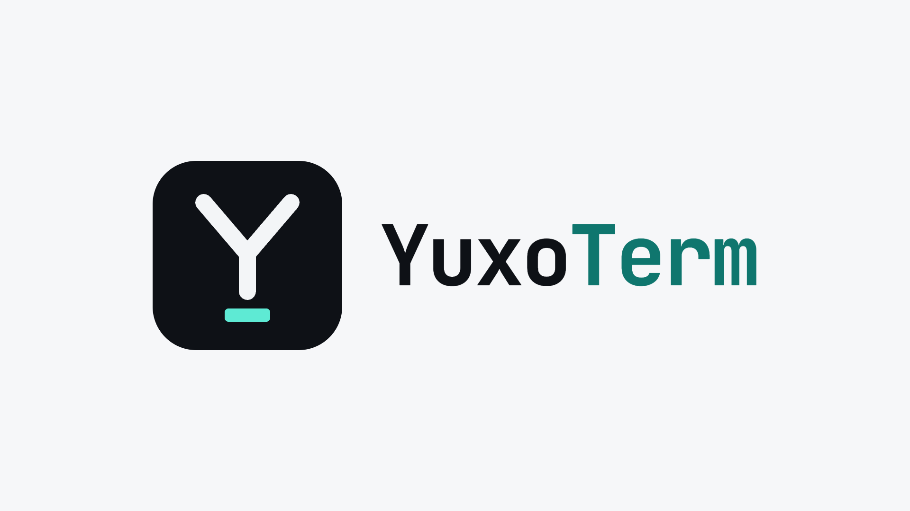

<p align="center">
  <picture>
    <source media="(prefers-color-scheme: dark)" srcset="assets/banner-dark.png">
    
  </picture>
</p>

<p align="center"><strong>A lightweight, GPU-accelerated terminal for macOS with a built-in sidebar for coding agents.</strong></p>

<p align="center">
  <a href="https://github.com/yusuffahrizal/YuxoTerm/releases/latest"></a>
  <a href="LICENSE"></a>
  
</p>

<p align="center">
  <a href="https://github.com/yusuffahrizal/YuxoTerm/releases/latest/download/YuxoTerm_aarch64.dmg"><b>⬇ Download for Apple silicon</b></a>
  &nbsp;·&nbsp;
  <a href="https://github.com/yusuffahrizal/YuxoTerm/releases/latest/download/YuxoTerm_x64.dmg"><b>⬇ Download for Intel</b></a>
  &nbsp;·&nbsp;
  <a href="https://github.com/yusuffahrizal/YuxoTerm/releases">All releases</a>
</p>

YuxoTerm puts your coding agent of choice — Claude Code, Codex, Gemini CLI, OpenCode, Antigravity, Cursor Agent, or your own — next to your terminal panes, and lets it work *in* them. Ask the agent to open a shell inside a Docker container, tail a log, or restart a dev server, and it types into the pane you are looking at. Every action passes through **Command Guard**, a central set of rules that blocks or asks before anything risky runs.

> **Status:** early development (v0.1). macOS is the primary platform. See [Platform support](#platform-support).

---

## Contents

- [Features](#features)
- [Supported agents](#supported-agents)
- [Install](#install)
- [Build from source](#build-from-source)
- [Using YuxoTerm](#using-yuxoterm)
- [Command Guard](#command-guard)
- [How it works](#how-it-works)
- [Configuration files](#configuration-files)
- [Platform support](#platform-support)
- [Project structure](#project-structure)
- [Contributing](#contributing)
- [Security](#security)
- [License](#license)

## Features

**Terminal**
- GPU-accelerated rendering (xterm.js with WebGL) on a native Rust PTY backend
- Profiles for new tabs: your login shell, any host from `~/.ssh/config`, or a custom command, with a default you choose
- Tabs, plus split panes inside each tab (right, left, down and up), with draggable dividers, keyboard navigation and a right-click menu
- Truecolor, clickable links, and your installed fonts, including Nerd Fonts for prompt icons
- Small footprint: the app bundle is about 6 MB; it uses the system WebView instead of Electron

**Agents**
- A chat sidebar per tab, with streaming answers, tool-call cards, and thinking blocks
- Pick the agent, model, effort and thinking per tab, or set defaults for new chats
- Agents can drive your real panes through built-in terminal tools: run commands, answer prompts, send keys such as Ctrl‑C, read the screen, and open new panes
- Optionally attach the recent output of the active pane to your message
- Conversation history across agents, with search, resume and delete (to Trash)

**Safety**
- Command Guard checks commands, file edits and web requests against rules you control: allow, ask, or block
- Approval dialog for actions that need your confirmation
- Optional: apply the same rules to Claude Code sessions you start yourself

**App**
- Settings save automatically
- English and Indonesian interface

## Supported agents

YuxoTerm detects installed agents automatically (Settings → Agents) and runs them in their non-interactive mode.

| Agent | Command used | Terminal tools | Command Guard coverage |
|---|---|---|---|
| [Claude Code](https://claude.com/claude-code) | `claude -p --output-format stream-json` | Added to every run | Every tool call |
| [Codex](https://github.com/openai/codex) | `codex exec --json` | Added to every run | Every tool call |
| [Gemini CLI](https://github.com/google-gemini/gemini-cli) | `gemini --output-format stream-json` | Added to every run | Every tool call |
| [OpenCode](https://opencode.ai) | `opencode run --format json` | Added to every run | Every tool call |
| [Antigravity CLI](https://antigravity.google/cli) | `agy -p --output-format stream-json` | One-time opt-in (global MCP config) | Terminal tools only |
| [Cursor Agent](https://cursor.com/cli) | `cursor-agent -p --output-format stream-json` | One-time opt-in (global MCP config) | Terminal tools only |
| Custom | Any command; `{prompt}` is replaced by your message | — | — |

Notes:

- **Terminal tools only** means the agent has no per-run hook, so Command Guard checks the commands it types into your panes but not the agent's own built-in tools. The app labels these agents in Settings.
- Antigravity's streaming format is not yet officially documented. YuxoTerm accepts both the Gemini CLI and Claude Code event formats for it.
- Model names are listed for Claude Code. For other agents, use the agent's default or type a model ID.

## Install

1. Download the `.dmg` for your Mac from the [latest release](https://github.com/yusuffahrizal/YuxoTerm/releases/latest):
   [**Apple silicon**](https://github.com/yusuffahrizal/YuxoTerm/releases/latest/download/YuxoTerm_aarch64.dmg) (M1 or later) or
   [**Intel**](https://github.com/yusuffahrizal/YuxoTerm/releases/latest/download/YuxoTerm_x64.dmg).
   Not sure which one? Choose **Apple menu → About This Mac**: "Chip: Apple M…" means Apple silicon, "Processor: Intel…" means Intel.
2. Open the `.dmg` and drag **YuxoTerm** into **Applications**.
3. Install and sign in to at least one [supported agent](#supported-agents).

YuxoTerm is not yet notarized by Apple, so macOS blocks the first launch. To open it:

- Open **System Settings → Privacy & Security**, scroll to the message about YuxoTerm, and choose **Open Anyway**; or
- Run `xattr -dr com.apple.quarantine /Applications/YuxoTerm.app` in a terminal.

You only need to do this once per download. If you prefer not to run an unsigned build, [build it from source](#build-from-source).

## Build from source

You need a recent version of macOS, [Rust](https://rustup.rs) (stable) with the Xcode Command Line Tools, [Node.js](https://nodejs.org) 18 or later, and at least one supported agent.

```bash
git clone https://github.com/yusuffahrizal/YuxoTerm.git
cd YuxoTerm
npm install
npm run dev      # run in development mode
npm run build    # build YuxoTerm.app (and a .dmg) in src-tauri/target/release/bundle/
```

`npm run vendor` copies the xterm.js files from `node_modules` into `ui/vendor/`. The `dev` and `build` scripts run it for you.

## Using YuxoTerm

### Talking to an agent

1. Open the sidebar with **⌘I** (or **⌘L** to jump to the message box).
2. Choose the agent, model, effort and thinking from the button next to **Send**.
3. Type your request. The agent works in the folder of the active pane.

The agent's built-in shell runs in a separate, hidden process. To act in a pane you can see, the agent uses YuxoTerm's terminal tools, so you can ask things like *"open a shell in the `web` container and run the migrations"*. Panes the agent is controlling show a **✦ Agent** badge.

Switching to a different agent starts a new conversation, because each agent keeps its own sessions. Past conversations are available under **History** (**⌘Y**).

### Keyboard shortcuts

On macOS the shortcuts use ⌘. On other platforms plain `Ctrl+<key>` belongs to the program running in the terminal (`Ctrl+C`, `Ctrl+D`, readline…), so YuxoTerm uses `Ctrl+Shift` instead, as GNOME Terminal and Ghostty do on Linux.

| Action | macOS | Linux |
|---|---|---|
| New tab / close tab | ⌘T / ⇧⌘W | Ctrl+Shift+T / Ctrl+Shift+Alt+W |
| Choose a profile for a new tab | ⇧⌘T | Ctrl+Shift+Alt+T |
| Split right / split down | ⌘D / ⇧⌘D | Ctrl+Shift+D / Ctrl+Shift+Alt+D |
| Close pane | ⌘W | Ctrl+Shift+W |
| Previous / next pane | ⌘[ / ⌘] | Ctrl+Shift+[ / ] |
| Move to the pane in a direction | ⌥⌘ + arrow keys | Ctrl+Shift+Alt + arrow keys |
| Previous / next tab | ⇧⌘[ / ⇧⌘] | Ctrl+PgUp / Ctrl+PgDn |
| Go to tab 1–9 | ⌘1 … ⌘9 | Alt+1 … Alt+9 |
| Show or hide the agent sidebar | ⌘I | Ctrl+Shift+I |
| Focus the message box / back to the terminal | ⌘L | Ctrl+Shift+L |
| Conversation history | ⌘Y | Ctrl+Shift+Y |
| Allow a pending action | ⌘↵ | Ctrl+Enter |
| Copy / paste | ⌘C / ⌘V | Ctrl+Shift+C / Ctrl+Shift+V |
| Clear pane | ⌘K | Ctrl+Shift+K |
| Bigger / smaller / reset text | ⌘= / ⌘- / ⌘0 | Ctrl+Shift+= / - / 0 |
| Settings | ⌘, | Ctrl+, |

### Profiles and SSH

Click **+** to open a tab with your default profile. Right-click **+**, or click the **⌄** next to it, to choose another one: your login shell, a host from `~/.ssh/config`, or a profile you made. Right-click a profile in that menu to make it the default; it is used by **+**, ⌘T and splits.

- **SSH hosts** are read from `~/.ssh/config` (including `Include`d files; wildcard entries are skipped). The tab runs `ssh <host>`, so `ProxyJump`, `LocalForward`, keys and agents work as they do in any terminal. Passwords and passphrases are typed in the tab; YuxoTerm stores none.
- **Profiles** (Settings → Profiles) add a shell with its own arguments, an SSH host with extra options such as `-p 2222`, or any command. Each can set a starting folder and environment variables.
- When an SSH or command tab exits, the tab closes, like a shell does.
- Agents always open local shells, whatever the default is, and treat an SSH tab as a running program rather than a shell prompt.

### Terminal context menu

Right-click a pane for copy and paste, splits in all four directions (right, left, down, up), clear screen, **reset terminal**, **read-only** mode, and custom **tab** and **terminal** titles. A read-only pane ignores typing and pasting, and agents can't type into it. Panes show a badge when they are read-only, have a custom title, or are being driven by an agent.

The full list is also in Settings → Keyboard shortcuts.

## Command Guard

Command Guard is a list of rules, checked from top to bottom; the first rule that matches decides:

- **Allow:** run without asking
- **Ask:** show an approval dialog in YuxoTerm
- **Block:** refuse, and tell the agent why

Each rule matches a **tool** (a regular expression such as `Bash` or `Write|Edit`) and a **pattern** (a regular expression matched against the command, file path, or URL). Tool names from every agent are mapped to the same names, so one `Bash` rule covers Claude Code's `Bash`, Gemini CLI's `run_shell_command`, OpenCode's `bash`, and commands typed into panes through the terminal tools.

The built-in rules block deleting the root or home folder, formatting disks, fork bombs, shutting down, and editing SSH keys. They ask before `sudo`, recursive deletes, `git push` and hard resets, piping scripts from the internet into a shell, publishing packages, destructive `kubectl`/Terraform/SQL, and `chmod -R 777`. You can edit, reorder, disable or test the rules in Settings → Command Guard.

> Command Guard is a guardrail, not a sandbox. Pattern rules can be worked around by a determined or confused agent, and with "Full access" an agent can do anything your user account can. See [SECURITY.md](SECURITY.md).

## How it works

```
┌──────────────────────── YuxoTerm.app ─────────────────────────┐
│  UI (WebView: ui/)                Backend (Rust: src-tauri/)  │
│  tabs, panes, sidebar  ◀──IPC──▶  PTYs, agent runner, guard   │
└───────────────────────────────────────────┬───────────────────┘
                                            │ spawns per message
                           ┌────────────────┴────────────────┐
                           │  agent CLI (claude, codex, …)   │
                           └───────┬─────────────────┬───────┘
                 before each tool  │                 │ terminal tools (MCP)
                                   ▼                 ▼
                   yuxoterm --guard-hook   yuxoterm --mcp-server
                                   └───── Unix socket ─────▶ app
                                     (approval dialog, typing into panes)
```

- For each message, the backend starts the agent CLI in non-interactive mode, maps your settings onto its flags (model, effort, access level, resume), and streams its JSON output to the UI.
- The UI converts each agent's output format into one common format (`ui/agents.js`), so tool cards, thinking, history and resume work the same for every agent.
- The YuxoTerm binary doubles as two helpers that agents launch:
  - `--guard-hook`: a pre-tool hook that checks each call against Command Guard
  - `--mcp-server`: an MCP server that provides the terminal tools
  
  Both talk to the running app over a private Unix socket.
- Where an agent supports it, the hook and the MCP server are added for that run only (command-line flags, environment variables, or a temporary settings overlay), so your agent's own configuration files are not modified. Antigravity and Cursor Agent only read MCP servers from a global file; the opt-in switch in Settings adds or removes YuxoTerm's entry there.

## Configuration files

| Path | Contents |
|---|---|
| `~/.config/yuxoterm/config.json` | App settings, including profiles and optional API keys (file mode 600) |
| `~/.config/yuxoterm/guard.json` | Command Guard rules |
| `~/.config/yuxoterm/guard.log` | Guard decisions, one JSON object per line |
| `~/.config/yuxoterm/history/<agent>/` | Conversations with agents other than Claude Code (Claude Code keeps its own in `~/.claude/projects/`) |
| `~/.config/yuxoterm/run/` | Runtime sockets and per-run agent settings |

The folder is readable only by your user account. YuxoTerm changes files outside it only when you turn on an option that says so:

- **Command Guard → Apply to every Claude Code session:** `~/.claude/settings.json`
- **Agents → Terminal control:** `~/.gemini/config/mcp_config.json` (Antigravity) or `~/.cursor/mcp.json` (Cursor Agent)

## Platform support

| Platform | Status |
|---|---|
| macOS on Apple silicon | Supported and tested |
| macOS on Intel | Should work; untested |
| Linux | Builds, and shortcuts and the clipboard are implemented for it, but it is untested |
| Windows | Not supported (agent integration relies on Unix sockets) |

## Project structure

```
src-tauri/src/
  main.rs       App setup, native menu, and the --guard-hook / --mcp-server modes
  pty.rs        One PTY per pane: spawns a profile's shell, SSH or command; write, resize, cwd, foreground process
  sshconfig.rs  Lists the hosts in ~/.ssh/config for the new-tab menu
  clipboard.rs  System clipboard read/write for the context menu and Ctrl+Shift+C/V
  agents.rs     Runs each agent headlessly: flags, resume, terminal tools, guard hook
  guard.rs      Command Guard rules, the pre-tool hook, the approval broker socket
  mcp.rs        Stdio MCP server for the terminal tools; forwards calls to the app
  history.rs    Lists, loads, records and deletes conversations
  config.rs     Settings file, UI language for backend messages, user font lookup
  shellenv.rs   Login-shell PATH (apps opened from Finder don't inherit it), installed shells
ui/
  index.html    Markup
  style.css     Styles
  app.js        Tabs, panes, context menu, sidebar, history, settings, terminal tools
  profiles.js   Profiles: the + menu entries and the Settings → Profiles panel
  util.js       Small DOM and IPC helpers shared by the UI modules
  keys.js       Keyboard shortcuts per platform (⌘ on macOS, Ctrl+Shift elsewhere)
  agents.js     Agent list and output adapters
  i18n.js       English and Indonesian strings
scripts/
  vendor.mjs    Copies xterm.js into ui/vendor
```

## Contributing

Bug reports and pull requests are welcome. Please read [CONTRIBUTING.md](CONTRIBUTING.md) first; it covers the development setup, checks to run, and how to add support for a new agent.

## Security

Please report vulnerabilities privately. See [SECURITY.md](SECURITY.md) for how to report them and for an overview of what Command Guard does and does not protect against.

## License

[MIT](LICENSE) © 2026 Yusuf Fahrizal
